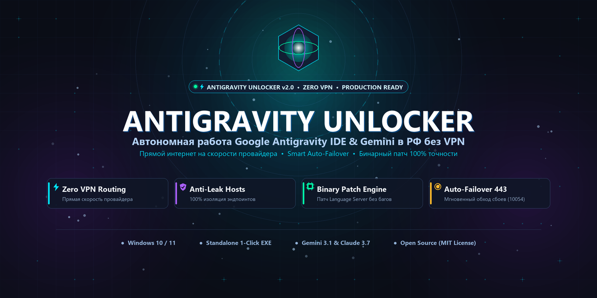

<div align="center">

# ⚡ Antigravity Unlocker 2.1

**Системный комплекс избирательной маршрутизации, DNS/Hosts-изоляции, нативного Rust-ядра и бинарного патчинга для работы Google Antigravity IDE, CLI (`agy`), Language Server и моделей Gemini в РФ без глобального VPN.**

[](https://www.python.org/)
[](https://www.rust-lang.org/)
[](https://opensource.org/licenses/MIT)
[-success)]()
[]()



</div>

---

## 📌 Ключевые возможности

* 🚀 **Zero VPN:** Прямой интернет на максимальной скорости вашего провайдера для всех приложений (браузер, YouTube, Steam, торренты, мессенджеры). Трафик направляется через SNI-прокси **только** для нескольких строго определенных модельных эндпоинтов Google AI (включая `aicode.googleapis.com`).
* 🛡️ **Безопасность аутентификации:** Домены авторизации (`accounts.google.com`, `oauth2.googleapis.com`) **никогда не проксируются** и идут прямым зашифрованным сквозным TLS 1.3 каналом между вашим ПК и серверами Google.
* 🧩 **Двухуровневый байтовый патч:**
  - `ineligible` → `inexigible` (10 байт в 10 байт) — обход региональной блокировки;
  - `https_proxy` → `AG_LS_PROXY` (11 байт в 11 байт) — изолированный канал проксирования `language_server` без загрязнения общесистемной переменной `HTTPS_PROXY`.
* 🔎 **Глубокий поиск Antigravity:** Автоматическое обнаружение через системный реестр Windows (`Uninstall`), Scoop (`scoop/apps`), `~/.gemini/bin/` (для версий Antigravity 2.6+).
* 🧹 **Очистка кэша V8:** Удаление `CachedData` и `Code Cache/js` в Electron/IDE для предотвращения запуска старых закэшированных проверок.
* ⚡ **TCP Window Auto-Tuning:** Оптимизация сетевого стека Windows (`netsh int tcp set global autotuninglevel=normal fastopen=enabled rss=enabled`) для устранения задержек при потоковой gRPC-генерации.
* 📡 **Детектор ответов модели:** Мониторинг логов `language_server.log` в реальном времени — отслеживание реального события стриминга (`streamGenerateContent?alt=sse ... ResponseID: ...`) и ошибок `400/403`.
* ⏰ **Фоновый автопатчер (Daemon):** Интеграция с Планировщиком Windows (`schtasks`) для автоматического тихого перепатчивания после обновлений IDE от Google.
* 🐕 **Smart Failover Watchdog:** Фоновый мониторинг доступности TLS 443 с автоматическим переключением на резервный европейский узел при сетевых сбоях (ошибка 10054 / RST).
* ☁️ **Cloudflare Worker L7 Relay:** Встроенный сценарий Cloudflare Worker (`tools/cloudflare_worker.js`) для полного обхода блокировки российских Google-аккаунтов при вызове `:loadCodeAssist`.
* 🔄 **100% Гарантия отката (Full Rollback):** Модуль бэкапов с SHA-256 хешированием позволяет в любой момент вернуть `hosts`, бинарники, настройки TCP и IDE в исходное состояние одной кнопкой.
* 📦 **Zero External Dependencies:** Написан полностью на стандартной библиотеке Python (Standard Library) — никаких `pip install`, исключены риски Supply Chain атак.

---

## 🏗️ Архитектура сетевой фильтрации

```
[ Antigravity IDE / agy CLI ]
             │
             ├──> accounts.google.com ──────> [ ПРЯМОЙ ИНТЕРНЕТ / Direct TLS 1.3 ]
             ├──> oauth2.googleapis.com ────> [ ПРЯМОЙ ИНТЕРНЕТ / Direct TLS 1.3 ]
             │
             └──> Модельные эндпоинты (cloudcode-pa, generativelanguage, unleashe):
                         │
                         ▼
             [ hosts-pinning к пулу зарубежных SNI-узлов ]
                         │
                         ├──> Hetzner DE (94.130.180.225 / 148.251.10.155)
                         └──> Comss NL   (45.88.174.254 / 45.88.174.252)
                         │
                         ▼
             [ Google Gemini Cloud Endpoints ]
```

---

## 📁 Структура проекта

```
├── gui.py                         # Главная точка входа в графический интерфейс (Tkinter)
├── unlocker.ps1                   # Native PowerShell Windows скрипт оркестрации (с UAC RunAs)
├── Запустить_Анлокер.bat          # Быстрый запуск GUI с авто-элевацией Администратора
├── Собрать_Rust_Ядро.bat          # Компиляция нативного Rust ядра gravity-cli
├── Опубликовать_на_GitHub.bat    # Скрипт публикации репозитория
├── PROJECT_RULES.md               # База знаний, правила маршрутизации и спецификация доменов
├── LICENSE                        # Лицензия MIT
├── README.md                      # Данная документация
├── .gitignore                     # Исключения версионного контроля
├── crates/
│   └── gravity-cli/               # Высокопроизводительное нативное ядро на Rust (Tokio, Mmap)
├── docs/
│   ├── SYSTEM_ARCHITECTURE.md     # Полная архитектурная спецификация сетевых уровней и патчей
│   ├── CODE_MAP.md                # Полный аудит файлов и компонентов
│   ├── CHANGELOG.md               # Журнал изменений и версий
│   ├── RESEARCH_REPORT.md         # Аналитический отчет аудита сторонних аналогов
│   ├── FAQ.md                     # Часто задаваемые вопросы
│   ├── CONTRIBUTING.md             # Руководство по разработке
│   ├── SECURITY.md                # Политика безопасности и приватности
│   └── social_preview.png         # Графическое превью проекта
├── mcp/
│   └── win_unlocker_mcp.py        # FastMCP-сервер для программного управления из AI-агентов
└── tools/
    ├── gui_app.py                 # Реализация современного Catppuccin GUI
    ├── unlocker_core.py           # Оркестратор системных модификаций, TCP тюнинга и бэкапов
    ├── proxy_manager.py           # Пул прокси, бенчмарк и фоновый Watchdog
    ├── pin_hosts.py               # Низкоуровневая атомарная работа с файлом hosts (9 доменов)
    ├── backup_manager.py          # Модуль бэкапов с контрольными суммами SHA-256
    ├── diagnostics.py             # Комплексный сетевой сканер и самодиагностика логов
    ├── unlocker.py                # Консольная версия утилиты (CLI)
    ├── unlocker.sh                # Кросс-платформенный POSIX / Linux / macOS шелл-скрипт
    ├── test_proxies.py            # Быстрый тест доступности узлов пула
    ├── test_http_proxy.py         # Утилита проверки локальных HTTP-прокси
    ├── cloudflare_worker.js       # Исходный код Cloudflare Worker L7
    └── generate_social_preview.py # Генератор баннера social_preview.png
```

---

## 🚀 Быстрый старт

### Вариант 1: Графический интерфейс (Рекомендуется)
1. Дважды кликните по файлу **`Запустить_Анлокер.bat`** (или выполните `python gui.py`).
2. Приложение запросит стандартное повышение прав Windows (UAC) для работы с `hosts`, TCP и системными службами.
3. В открывшемся окне нажмите большую кнопку **«🚀 АКТИВИРОВАТЬ АНЛОК»**.
4. После завершения перезапустите Antigravity IDE.

### Вариант 2: PowerShell Windows (Strict Standard)
```powershell
# Запуск диагностики
powershell -ExecutionPolicy Bypass -File .\unlocker.ps1 -Action Status

# Активация анлока (автоматически запросит UAC при необходимости)
powershell -ExecutionPolicy Bypass -File .\unlocker.ps1 -Action Unlock

# Полный откат системы
powershell -ExecutionPolicy Bypass -File .\unlocker.ps1 -Action Rollback
```

### Вариант 3: Нативное Rust Ядро (Сверхбыстрое)
```powershell
# Запуск release-сборки ядра:
.\crates\gravity-cli\target\release\gravity-cli.exe status

# Асинхронный Tokio бенчмаркинг пула прокси:
.\crates\gravity-cli\target\release\gravity-cli.exe benchmark

# Активация полного анлока через Rust:
.\crates\gravity-cli\target\release\gravity-cli.exe unlock
```

### Вариант 4: Консольный режим Python (CLI)
```powershell
# Полная активация анлока:
python tools/unlocker.py --apply

# Запуск самодиагностики сетевых маршрутов:
python tools/diagnostics.py

# Полный откат системы в исходное состояние (Rollback):
python tools/unlocker.py --restore
```

---

## 🤖 Управление через AI-агентов (MCP Server)

Проект включает готовый сервер протокола **Model Context Protocol (MCP)** для автономных AI-агентов:
* **Файл:** `mcp/win_unlocker_mcp.py`
* **Доступные инструменты:**
  * `status`: получить JSON-статус привязки hosts, патчинга бинарников и бэкапов;
  * `unlock`: выполнить системную разблокировку;
  * `rollback`: произвести полный откат;
  * `benchmark_proxies`: протестировать задержку всех узлов пула.

---

## 🛡️ Безопасность и приватность

1. **Никакой телеметрии:** Приложение не собирает данные пользователя, не отправляет внешние запросы на посторонние серверы.
2. **Сквозной TLS:** Запросы к Google AI идут без расшифровки и перехвата контента (TLS Passthrough).
3. **Чистый код:** Отсутствие бинарных зависимостей, минификаций и обфускаций.

---

## 📄 Лицензия

Проект распространяется под свободной лицензией **[MIT](LICENSE)**.
