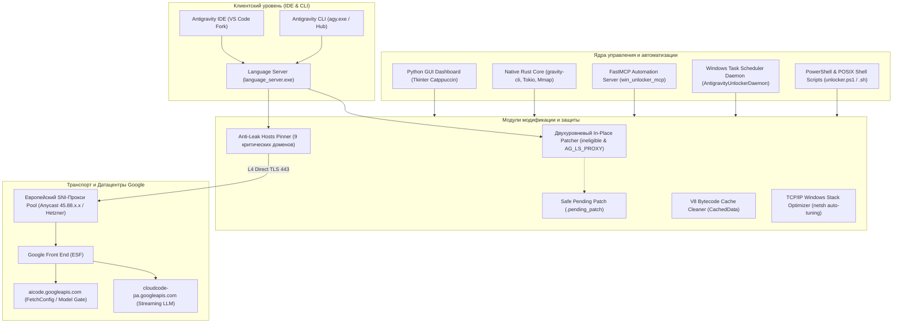

# 🏛️ Архитектура системы: Antigravity Unlocker 2.1

В данном документе детально описаны инженерные принципы, сетевые протоколы, структура системных модификаций, компоненты защиты и взаимодействие подсистем комплекса **Antigravity Unlocker 2.1**.

---

## 1. Концептуальная архитектура

Antigravity Unlocker 2.1 построен на принципе **избирательной гибридной изоляции (Selective Hybrid Isolation & Routing)**.  
Вместо перенаправления глобального трафика системы через медленные или ненадежные VPN-туннели, маршрутизируется и модифицируется **исключительно модельный и конфигурационный контур Google AI**, оставляя системный интернет, браузеры, Git и корпоративные сервисы нетронутыми.

---

## 2. Ключевые компоненты и зоны ответственности

| Компонент | Расположение | Язык / Технология | Зона ответственности |
| :--- | :--- | :--- | :--- |
| **Unified Core** | `tools/unlocker_core.py` | Python 3 | Единый движок анлока, отката, бэкапов, патчинга и планировщика. |
| **GUI Dashboard** | `tools/gui_app.py`, `gui.py` | Python (Tkinter) | Графическая панель управления в стиле Catppuccin Mocha с 8 карточками статуса. |
| **Native Rust Engine** | `crates/gravity-cli/` | Rust 1.75+ (Tokio, Memmap2, Clap) | Высокопроизводительное zero-dependency консольное ядро с асинхронным бенчмаркингом и mmap-патчингом. |
| **FastMCP Server** | `mcp/win_unlocker_mcp.py` | Python (FastMCP) | MCP-инструменты для прямого программного управления агентами AI (Cursor, Windsurf, Claude). |
| **Proxy Manager** | `tools/proxy_manager.py` | Python (Socket, SSL) | Пул быстрых европейских SNI-прокси, многопоточный TLS-бенчмаркинг, фоновый вотчдог авто-переключения. |
| **Hosts Pinner** | `tools/pin_hosts.py` | Python | Атомарная привязка 9 целевых доменов в системный `hosts` с автоматическим резервным копированием. |
| **Diagnostics Suite** | `tools/diagnostics.py` | Python | 7-этапная диагностика: `hosts`, NRPT, DNS, TLS 443, бинарные патчи, парсер живых логов, TCP стек. |
| **PowerShell Orchestrator** | `unlocker.ps1` | PowerShell (Windows) | Строгий native скрипт управления с поддержкой UAC само-элевации и ASCII-статусами. |
| **POSIX Shell Script** | `tools/unlocker.sh` | Bash (`set -euo pipefail`) | Кросс-платформенный скрипт для Linux и macOS сред. |

---

## 3. Механизм обхода ограничений (Двухуровневый In-Place Patching)

В Antigravity 2.6+ проверка доступности AI разделена на два уровня:
1. **Региональный гейт (`ineligible` -> `inexigible`):**
   - Библиотека Google содержит бинарный литерал `ineligible` (10 байт: `69 6e 65 6c 69 67 69 62 6c 65`).
   - Заменяется на `inexigible` (10 байт: `69 6e 65 78 69 67 69 62 6c 65`).
   - Точное сохранение длины защищает смещения секций PE, адресацию инструкций и Protobuf-сериализацию.
2. **Изолированный канал прокси (`https_proxy` -> `AG_LS_PROXY`):**
   - Сетевой стек Go (`golang.org/x/net/http/httpproxy`) по умолчанию читает глобальные переменные окружения `HTTPS_PROXY` и `https_proxy`.
   - Замена литерала `https_proxy` на `AG_LS_PROXY` (11 байт в 11 байт) обеспечивает Antigravity собственный выделенный канал проксирования без влияния на глобальные утилиты разработчика (`git`, `npm`, `curl`, `pip`, браузеры).
3. **Безопасное отложенное применение (`.pending_patch`):**
   - Если исполняемый файл (например, `agy.exe` или `language_server.exe`) заблокирован активным процессом IDE, утилита не сбивает процесс, а записывает файл `.pending_patch`.
   - При следующем перезапуске системы, вызове фонового автопатчера или скрипта обновления отложенный патч применяется мгновенно.

---

## 4. Спецификация сетевого контура и доменов

Маршрутизация осуществляется через привязку IP в `%SystemRoot%\System32\drivers\etc\hosts`:

| Домен | Назначение | Порт | Протокол |
| :--- | :--- | :--- | :--- |
| `cloudcode-pa.googleapis.com` | Стриминг генерации токенов (LLM Streaming) | 443 | HTTP/2, gRPC, TLS |
| `daily-cloudcode-pa.googleapis.com` | Ежедневные обновления и контекстные модели | 443 | HTTP/2, gRPC, TLS |
| `generativelanguage.googleapis.com` | Gemini 1.5/2.0 Pro/Flash Direct API | 443 | HTTP/2, REST, SSE |
| `aicode.googleapis.com` | Проверка профиля аккаунта (FetchConfig) | 443 | HTTP/2, gRPC, TLS |
| `antigravity-unleash.goog` | Сервер фичефлагов (Rollouts / A/B Testing) | 443 | HTTP/2, TLS |
| `cloudaicompanion.googleapis.com` | Контекстные подсказки и интеграция IDE | 443 | HTTP/2, TLS |
| `jetski-webchannel.googleapis.com` | Двунаправленный стриминг WebChannel | 443 | WebSockets / HTTP/2 |
| `antigravity.google` | Основной портал телеметрии и проверки лицензий | 443 | HTTPS, TLS |
| `alkalimakersuite-pa.googleapis.com` | Интеграция MakerSuite и прототипирование | 443 | HTTP/2, TLS |

> **ВАЖНО (Zero-Compromise Security):** Домены авторизации (`accounts.google.com`, `oauth2.googleapis.com`) **НИКОГДА** не перенаправляются через прокси и резолвятся напрямую. Ваши токены сессий и учетные данные Google передаются исключительно на официальные серверы Google.

---

## 5. Очистка кэша V8 и оптимизация TCP/IP

### Очистка байткод-кэша V8
Electron и VS Code кэшируют скомпилированный байткод JavaScript в каталогах:
- `%APPDATA%\Antigravity\CachedData`
- `%APPDATA%\Antigravity\Code Cache\js`
- `%APPDATA%\Antigravity IDE\CachedData`

Функция `clean_ide_cache()` удаляет устаревший скомпилированный байткод, гарантируя немедленное вступление изменений в силу без задержек.

### Тюнинг сетевого стека Windows
Для предотвращения сбросов TCP-соединений (`WSAECONNRESET 10054`) при непрерывном SSE/gRPC стриминге токенов применяются оптимальные параметры TCP:
- `autotuninglevel=normal` — динамическое масштабирование окна TCP Receive Window (RWIN).
- `fastopen=enabled` — TCP Fast Open для снижения задержки первого пакета.
- `rss=enabled` — Receive Side Scaling для распределения сетевой нагрузки по ядрам CPU.
- `hystart=enabled` & `prr=enabled` — быстрое восстановление при кратковременных сетевых потерях.
- Исходное состояние сетевого стека сохраняется в `backups/tcp_state.json` для бесследного отката.
